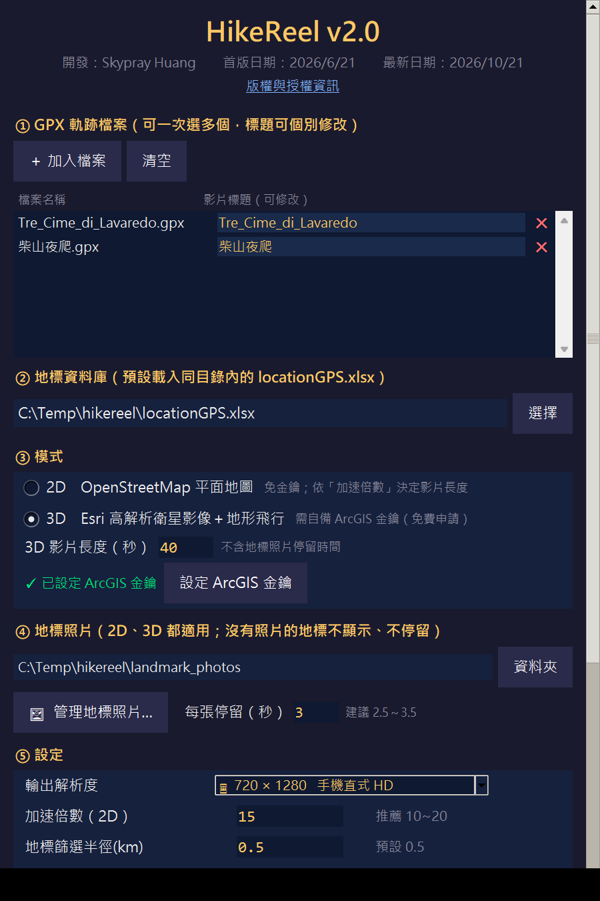
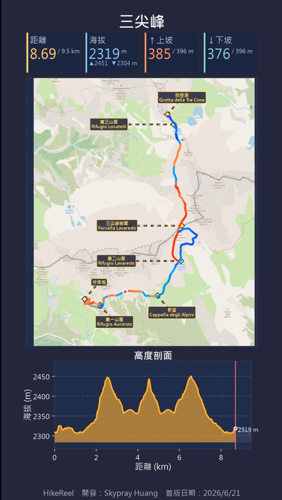
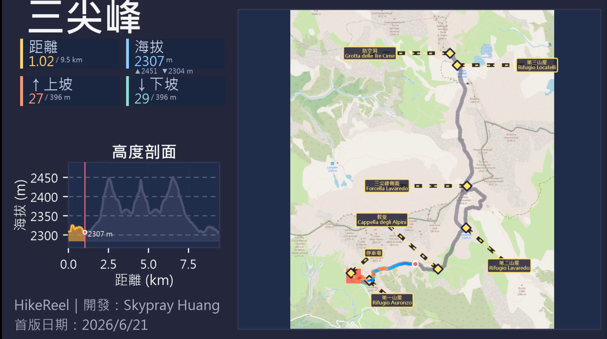
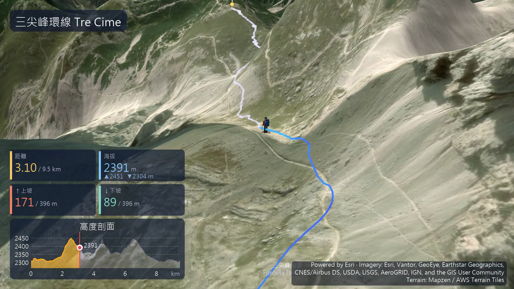
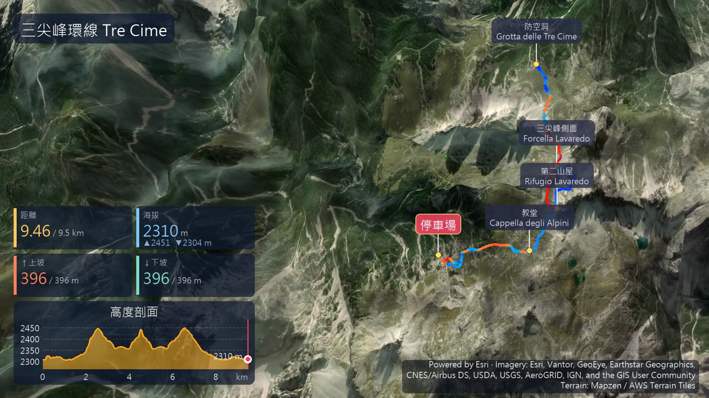

# HikeReel v2.0.1

**HikeReel** 把 GPX 健行軌跡轉換成動態影片，適合上傳 YouTube Shorts、Instagram Reels 或 YouTube。

- **2D 模式**：OpenStreetMap 平面地圖，免金鑰。
- **3D 模式**：Esri 高解析衛星影像貼在真實地形上，鏡頭跟著登山小人沿路線飛行（需自備免費的 ArcGIS 金鑰）。
- 兩種模式都支援**地標標籤**與**地標照片**。

## ⬇️ 下載執行檔（Windows）

> 不需要安裝 Python，下載即用。

**[➡️ 前往下載頁面（Releases）](https://github.com/skypray73/HikeReel/releases/latest)**

下載 `HikeReel_v2.0.1_Windows.zip`，**整個解壓縮**後執行資料夾裡的 `HikeReel.exe`：

```
HikeReel_v2.0.1/
├─ HikeReel.exe         主程式
├─ _internal/           程式需要的套件（不要刪除或移動）
├─ locationGPS.xlsx     地標資料庫範本
├─ LICENSE              授權條款
└─ README.txt           簡易說明
```

> - 請把整個資料夾放在**純英文路徑**（例如 `D:\HikeReel_v2.0.1`）。
> - 建議另外安裝 ffmpeg（見下方說明），影片品質與相容性較好。
> - 執行檔沒有程式碼簽章，Windows SmartScreen 可能出現警告，請按「其他資訊」→「仍要執行」。

---

## 截圖

### GUI 介面


### 2D 直式輸出（手機 / YouTube Shorts）


### 2D 橫式輸出（電腦 / YouTube）


### 3D 地形飛行（Esri 衛星影像、登山小人）


### 3D 結尾總覽（抵達終點後拉遠，呈現整段軌跡與最終數據）


---

## 功能特色

- 🗺️ **2D / 3D 兩種模式**，在 GUI 一鍵切換
- 🧍 **3D 登山小人**：背包、登山杖，沿路線走路前進；鏡頭低角度跟隨，看得出地形起伏
- 🖼️ **地標照片**：走到有照片的地標時停下，照片卡片淡入並緩慢推近（預設 3 秒），自動轉正、自動裁切；沒有照片的地標不顯示、不停留
- 🎨 路線以坡度上色（上坡橘紅、下坡藍青）
- 📊 動態儀表板：距離 / 海拔 / 累積上坡 / 累積下坡，以及高度剖面圖
- 📍 自訂地標標籤（locationGPS.xlsx），3D 中被山擋住會自動淡出
- 🎬 多種解析度（720p / 1080p / 2K / 4K，直式 / 橫式）
- ⚡ GPU 加速（需安裝 ffmpeg + NVIDIA）
- 🖥️ GUI 視窗介面，支援批次處理多個 GPX
- 📱 直式佈局符合 YouTube Shorts 安全邊界

---

## 使用方式（GUI）

1. 點「＋ 加入檔案」選擇 GPX 檔案（可多選），可修改每個檔案的影片標題
2. 選擇地標資料庫（預設載入同資料夾的 `locationGPS.xlsx`）
3. 選模式：
   - **2D OpenStreetMap**：影片長度由「加速倍數」決定
   - **3D Esri**：第一次選會提示輸入 ArcGIS 金鑰（見下方）；可設定影片長度（秒）
4. （選用）按「🖼 管理地標照片…」幫地標挑照片
5. 設定解析度，按「▶ 開始批次產生影片」

輸出影片放在 GPX 同一資料夾：2D 為 `路線 (寬x高).mp4`，3D 為 `路線 3D (寬x高).mp4`。

---

## 🏔️ 3D 模式與 ArcGIS 金鑰

3D 模式使用 **Esri World Imagery** 高解析衛星影像（約 1～2 m），需要你自己的 **ArcGIS Location Platform** 金鑰，免費申請：

1. 到 [location.arcgis.com](https://location.arcgis.com/) 註冊並登入
2. 「開發人員認證」→ 建立 **API 金鑰** → 選「**公開應用程式**」→「**無項目存取權**」
3. 權限只開「**底圖 → 靜態底圖圖磚**」，建議設定到期日
4. 複製金鑰，在 HikeReel 選 3D 時貼上（程式會先測試金鑰再儲存）

- 免費額度每月 200 萬張圖磚，一支影片約用 900 張；帳號若沒有開啟「依量付費」，超過額度只會暫停，不會收費。
- 金鑰只存在這台電腦的 Windows 使用者環境變數 `ARCGIS_API_KEY`，**不會上傳**；HikeReel 不內建任何金鑰。請勿把金鑰放進 GitHub。
- Esri 圖磚依伺服器回應標頭最多暫存 24 小時（同一天重做同一路線不必重新下載），過期自動刪除，不做永久離線保存。
- 用 Esri 影像製作的影片，**須保留畫面上的來源標示**；營利或商業用途請先確認 Esri 使用條款。

其他 3D 細節：
- 地形高程來自 [AWS Terrain Tiles](https://registry.opendata.aws/terrain-tiles/)，主地形外再加一圈約 4 倍範圍的低解析地形，遠處逐漸融入天空。
- 鏡頭跟著平滑過的路線、轉向速度有上限（每秒 20°），急轉彎與之字形路段也不會晃動。
- 開場從整條路線的總覽降到小人身後；結尾在小人抵達終點、停下後，鏡頭才慢慢拉遠約 4 秒（`--outro-seconds`），呈現整段軌跡與最終數據。
- 儀表板（距離 / 海拔 / 上坡 / 下坡）與高度剖面沿用 2D 模式的配色與版型，底色為半透明。
- 需要 OpenGL（一般顯示卡 / 內顯即可），使用 PyVista / VTK 離線渲染。
- 公司或學校網路若有 SSL 檢查，程式會自動改用 Windows 系統憑證（truststore）。
- 不使用 Google Earth / Google 地圖的圖資（授權不允許）。

---

## 🖼️ 地標照片（2D、3D 都適用）

- GUI：按「🖼 管理地標照片…」，在每個地標旁「選擇照片…」，照片會複製到地標庫旁的 `landmark_photos` 資料夾（檔名＝地標名稱第一行）。
- 也可以自己放：在 `landmark_photos` 資料夾放與地標同名的圖片（中文或外文那一行皆可），例如 `第一山屋.jpg`、`Rifugio Locatelli.jpg`；或在地標庫加一欄「**照片**」填檔案路徑。
- 每張停留秒數預設 3 秒（建議 2.5～3.5 秒：2 秒來不及看完照片和名稱，超過 4 秒會拖節奏）。
- 照片會依 EXIF 轉正、置中裁切成 4:3；支援 JPG / PNG / WebP / BMP，手機 HEIC 需另外安裝 `pillow-heif`。
- 只有找得到照片的地標才會停下來顯示照片。

---

## 如何取得 GPX 軌跡檔案

推薦使用 **[gpx.studio](https://gpx.studio/)** 線上繪製健行路線並匯出 GPX。

1. 開啟 https://gpx.studio/
2. 在地圖上點擊起點，沿路線依序點擊各個路徑點
3. 完成後點右上角「**Export**」→ 選「**GPX**」格式下載
4. 把下載的 `.gpx` 檔案加入 HikeReel 即可

> 也可以直接使用健行 App（Strava、Garmin Connect、Komoot、Relive 等）匯出的 GPX。

---

## 範例 GPX

`examples/` 資料夾內有示範用的 GPX 檔案，可直接加入 HikeReel 試用：

| 檔案 | 路線 | 地點 | 距離 | 海拔範圍 | 爬升 |
|---|---|---|---|---|---|
| Tre_Cime_di_Lavaredo.gpx | 三尖峰環線 | 義大利 南提洛 | 9.5 km | 2302～2453 m | 526 m |
| Adolf-Munkel-Weg.gpx | 阿道夫蒙克爾步道 | 義大利 南提洛 | 5.4 km | 1672～1943 m | 310 m |
| Alpe_di_Siusi.gpx | 西西爾高原 | 義大利 南提洛 | 3.4 km | 1848～2012 m | 66 m |
| Lago_di_Braies.gpx | 布萊埃斯湖環湖 | 義大利 南提洛 | 3.7 km | 1492～1534 m | 137 m |
| Resciesa.gpx | 雷奇沙山 | 義大利 南提洛 | 5.1 km | 2098～2280 m | 205 m |
| Santa_Maddalena.gpx | 聖瑪達萊納 | 義大利 南提洛 | 3.8 km | 1234～1349 m | 220 m |
| Seceda.gpx | 塞切達山 | 義大利 南提洛 | 2.3 km | 2440～2517 m | 104 m |
| 玉山主峰.gpx | 玉山主峰 | 台灣 南投 | 10.1 km | 2598～3927 m | 2106 m |
| 柴山夜爬.gpx | 柴山（壽山）夜爬 | 台灣 高雄 | 6.4 km | 18～333 m | 371 m |

---

## 系統需求

- Windows 10/11（64 位元）
- 3D 模式：支援 OpenGL 的顯示卡（內顯即可）、ArcGIS 金鑰
- Python 3.11+（直接下載 exe 則不需要）
- ffmpeg（選用，強烈建議安裝）

---

## 從原始碼執行

```
pip install -r requirements.txt
python gpx_video_app.py
```

### 命令列模式

2D：

```
python gpx_to_video.py your_track.gpx --title "路線名稱" --speed 15
```

| 參數 | 說明 | 預設值 |
|---|---|---|
| `--title` | 影片標題 | GPX 檔名 |
| `--speed` | 加速倍數 | 15 |
| `--width` / `--height` | 解析度 | 720 / 1280 |
| `--landmarks` | 地標資料庫路徑 | - |
| `--radius` | 地標篩選半徑 (km) | 0.5 |
| `--no-basemap` | 不下載底圖 | - |
| `--no-gpu` | 不使用 GPU | - |

3D（`python terrain3d.py --help` 看全部參數）：

```
python terrain3d.py examples/Tre_Cime_di_Lavaredo.gpx --title "三尖峰環線" --texture esri --seconds 40 --width 1920 --height 1080
```

| 參數 | 說明 | 預設值 |
|---|---|---|
| `--texture` | 貼圖：`esri`（需金鑰）、`topo`、`osm`、`s2-2016`、`s2-2024`（授權見下方） | topo |
| `--seconds` | 影片長度（不含照片停留） | 30 |
| `--photos` / `--photo-seconds` | 地標照片資料夾 / 每張停留秒數 | landmark_photos / 3 |
| `--marker` | `hiker` 登山小人 / `dot` 紅點 | hiker |
| `--exaggeration` | 地形高度誇張倍率 | 1.5 |
| `--cam-dist` / `--pitch` / `--shift` | 鏡頭距離 / 俯角 / 畫面垂直偏移 | 自動 |
| `--no-outer` / `--no-haze` | 不加外圍地形 / 不加遠景霧化 | - |

---

## 地標資料庫格式（locationGPS.xlsx）

| 名稱 | 座標 | 路線標籤 | 備註 | 照片（選用） |
|---|---|---|---|---|
| 第一山屋\nRifugio Auronzo | 46.61232, 12.29588 | Tre Cime | 海拔 2333m | landmark_photos/第一山屋.jpg |

- 座標格式：`緯度, 經度`（直接從 Google Maps 右鍵複製）
- 名稱可換行（中文在上、外文在下）
- 「照片」欄可省略，改用 `landmark_photos` 資料夾（見上方）
- `locationGPS.xlsx` 放在 exe 同一資料夾，程式啟動時自動載入

---

## ffmpeg 安裝（強烈建議）

| | 有 ffmpeg | 沒有 ffmpeg |
|---|---|---|
| 影片品質 | ⭐⭐⭐ H.264，各平台通用 | ⭐ mp4v，部分裝置可能無法播放 |
| 速度 | 快（支援 NVIDIA GPU 加速） | 較慢 |
| YouTube / IG 相容性 | ✅ 完全相容 | ⚠️ 部分平台可能拒絕上傳 |

**方式 A：用 winget 安裝（推薦）**

```
winget install Gyan.FFmpeg
```

**方式 B：手動下載**

1. 到 https://www.gyan.dev/ffmpeg/builds/ 下載 `ffmpeg-release-essentials.zip`
2. 解壓縮，找到 `bin\ffmpeg.exe`
3. 把 `ffmpeg.exe` 複製到和 `HikeReel.exe` 同一個資料夾

確認安裝成功：`ffmpeg -version`

---

## 解析度選項

| 選項 | 用途 |
|---|---|
| 720 × 1280 | 手機直式 HD（YouTube Shorts）|
| 1080 × 1920 | 手機直式 Full HD |
| 1440 × 2560 | 手機直式 2K |
| 2160 × 3840 | 手機直式 4K |
| 810 × 1440 | 平板直式 |
| 1280 × 720 | 電腦橫式 HD |
| 1920 × 1080 | 電腦橫式 Full HD |
| 2560 × 1440 | 電腦橫式 2K |
| 3840 × 2160 | 電腦橫式 4K |

---

## 打包成 .exe

請參閱 `打包說明.txt`（v2.0 起改為「主程式 + `_internal` 套件資料夾」，主程式小、啟動快）。

---

## 版權與授權

### HikeReel 程式碼

Copyright © 2026 Skypray Huang，以 [MIT License](LICENSE) 釋出。

### 地圖與影像資料

影片畫面上會自動標示資料來源，**公開分享時請保留**。

| 資料 | 用在 | 來源 / 授權 | 注意事項 |
|---|---|---|---|
| OpenStreetMap 圖磚 | 2D 底圖 | © OpenStreetMap contributors，[ODbL](https://opendatacommons.org/licenses/odbl/) | 依 [OSM 圖磚使用政策](https://operations.osmfoundation.org/policies/tiles/) 取得並快取在本機，請勿大量下載 |
| Esri World Imagery | 3D 衛星影像 | Powered by Esri · Source: Esri, Vantor, GeoEye, Earthstar Geographics, CNES/Airbus DS, USDA, USGS, AeroGRID, IGN, and the GIS User Community | 需自備 ArcGIS Location Platform 金鑰並遵守 Esri 使用條款；圖磚最多暫存 24 小時；營利或商業用途請先確認 Esri 條款 |
| AWS Terrain Tiles（Mapzen） | 3D 地形高程 | 資料來源含 SRTM、GMTED、ETOPO1、EU-DEM 等，見 [attribution](https://github.com/tilezen/joerd/blob/master/docs/attribution.md) | |
| OpenTopoMap（命令列選用） | 3D 貼圖 | © OpenStreetMap contributors, SRTM；地圖樣式 © OpenTopoMap（CC BY-SA） | |
| Sentinel-2 cloudless 2016（命令列選用） | 3D 貼圖 | EOX IT Services GmbH（含修改過的 Copernicus Sentinel 2016 & 2017 資料），CC BY 4.0 | 可商用，須標示來源 |
| Sentinel-2 cloudless 2024（命令列選用） | 3D 貼圖 | EOX IT Services GmbH（含修改過的 Copernicus Sentinel 2024 資料），CC BY-NC-SA 4.0 | **僅限非商業**；衍生影片須以相同條款分享 |

以上為依各資料提供者公開條款整理的說明，不構成法律意見；條款若有更新，以提供者公告為準。

### 你提供的內容

GPX 軌跡、地標資料庫與地標照片的版權屬於原作者，請確認你有權使用與公開。

### 使用的開源元件

| 元件 | 授權 |
|---|---|
| Python | PSF License |
| NumPy | BSD-3-Clause |
| Matplotlib | Matplotlib License（PSF-based） |
| OpenCV（opencv-python） | Apache-2.0 |
| Pillow | MIT-CMU |
| gpxpy | Apache-2.0 |
| contextily | BSD-3-Clause |
| pyproj | MIT |
| rasterio | BSD-3-Clause |
| mercantile | BSD-3-Clause |
| xyzservices | BSD-3-Clause |
| certifi | MPL-2.0 |
| openpyxl | MIT |
| PyVista | MIT |
| VTK | BSD-3-Clause |
| truststore | MIT |
| FFmpeg（另行安裝，不隨附） | LGPL-2.1+ / GPL（依編譯方式） |

---

## 開發者

**Skypray Huang**　首版日期：2026/6/21　v2.0：2026/10/21
